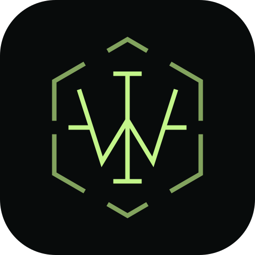
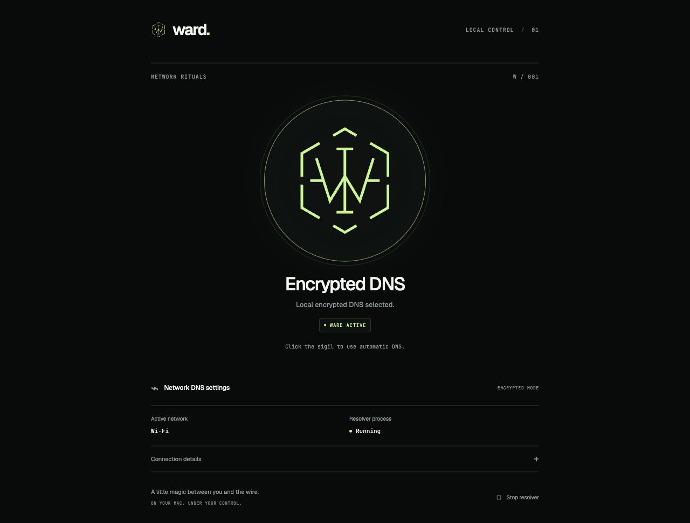
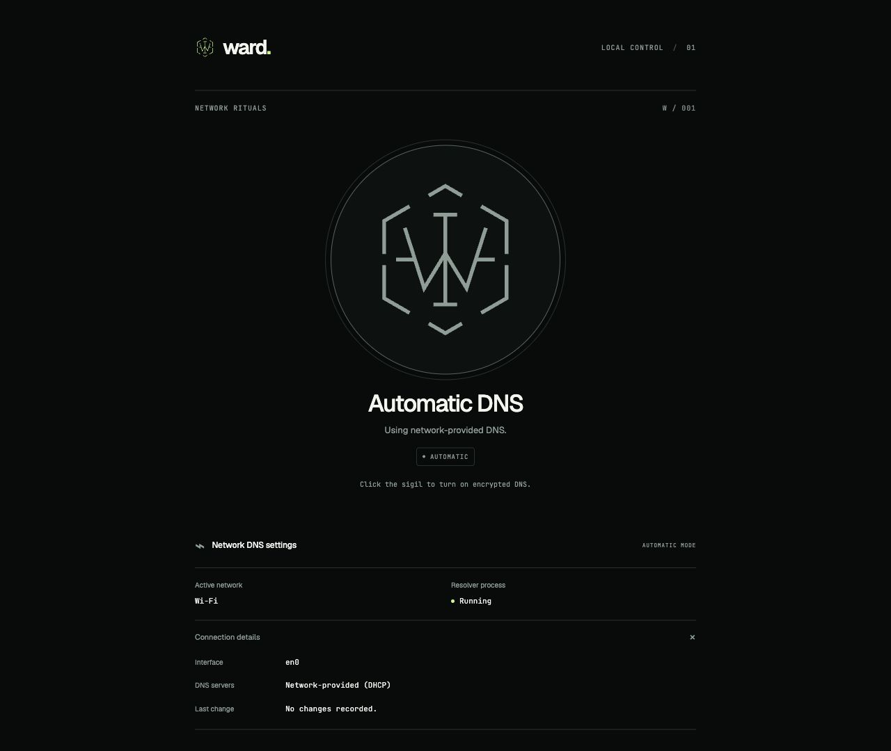

<div align="center">
  
  <h1>Ward</h1>
  <p><strong>A little magic between you and the wire.</strong></p>
  <p>A one-click encrypted DNS switch for your Mac.</p>
  <p>macOS · Bun · dnscrypt-proxy · Raycast optional</p>
  <p><a href="#install-on-a-new-mac">Install</a> · <a href="#raycast-optional">Raycast</a> · <a href="docs/OPERATIONS.md">Troubleshooting & maintenance</a> · <a href="LICENSE">MIT license</a></p>
</div>



## Your DNS, within reach

Click the circular Ward logo to switch your active network between a local encrypted resolver and automatic, network-provided DNS. A glowing sage sigil means local DNS is selected; a dim sigil means automatic DNS.

- **One clear control.** The logo is the on/off button, with keyboard support and accessible status updates.
- **A quiet local panel.** Network, resolver process and connection details at `http://127.0.0.1:43173`.
- **Raycast commands.** Check status, toggle, choose a mode or open the panel from your launcher.
- **Checks before switching.** The helper verifies the dedicated resolver's IPv4 and IPv6 loopback listeners over UDP and TCP, then checks DNS responses before changing network settings.
- **A deliberate stop.** Stop resolver restores automatic DNS before unloading Ward's dedicated resolver service.

<details>
<summary>See automatic DNS and connection details</summary>



</details>

*Screenshots show the real interface with sample network data; no personal configuration is pictured.*

Ward changes the DNS settings of the active macOS network service. It does not encrypt all network traffic, and apps with their own DNS, VPNs and managed network profiles may use a different route. Selecting automatic DNS clears custom DNS on that service; it does **not** restore previous manual DNS addresses. Record those addresses before your first toggle.

## Install on a new Mac

This is a source installation. You need an administrator account, an internet connection and a Mac supported by the current [Homebrew](https://docs.brew.sh/Installation) and [Bun](https://bun.sh/docs/installation) releases. Raycast and Node.js are optional. The example below uses an IPv4 internet connection and supports both IPv4 and IPv6 local DNS clients.

### 1. Install the tools

Open **Terminal**. Install Apple's Command Line Tools, then finish the macOS installer before continuing:

```sh
xcode-select --install
```

If macOS says the tools are already installed, continue. Install [Homebrew](https://brew.sh/) using its official installer:

```sh
/bin/bash -c "$(curl -fsSL https://raw.githubusercontent.com/Homebrew/install/HEAD/install.sh)"
```

Follow the installer's **Next steps** to add Homebrew to your shell. Its instructions account for the different paths on Apple silicon and Intel Macs. Then install Bun and dnscrypt-proxy:

```sh
brew install oven-sh/bun/bun dnscrypt-proxy
bun --version
"$(brew --prefix dnscrypt-proxy)/sbin/dnscrypt-proxy" -version
```

Leave the Homebrew resolver service stopped. Ward installs and manages its own copy; two resolvers cannot own the same port. If you already run another DNS service, review the [existing-resolver guidance](docs/OPERATIONS.md#another-resolver-or-vpn-is-already-running) first.

### 2. Download and build Ward

Choose a permanent home for the checkout. These commands use HTTPS, so no GitHub account or SSH key is needed to clone:

```sh
mkdir -p ~/Applications
cd ~/Applications
git clone https://github.com/mesterM12/dns-control.git
cd dns-control
bun install --frozen-lockfile
bun run build
```

The build creates `public/app.js`, which is intentionally excluded from Git. Keep this folder in place: the login service runs directly from it.

### 3. Choose and install a resolver

The included [starter configuration](examples/cloudflare-doh.toml) explicitly uses **Cloudflare's public, non-filtering DNS-over-HTTPS service**. Review its [privacy policy](https://developers.cloudflare.com/1.1.1.1/privacy/) and the configuration before choosing it. It needs no account, API key, external rule files or downloaded resolver lists. The public endpoint stamp comes from the [DNSCrypt resolver directory](https://github.com/DNSCrypt/dnscrypt-resolvers/blob/master/v3/public-resolvers.md#cloudflare).

If that provider suits you, run these commands from the checkout:

```sh
"$(brew --prefix dnscrypt-proxy)/sbin/dnscrypt-proxy" \
  -config "$PWD/examples/cloudflare-doh.toml" -check

bun run install:resolver \
  --binary "$(brew --prefix dnscrypt-proxy)/sbin/dnscrypt-proxy" \
  --config "$PWD/examples/cloudflare-doh.toml"
```

Approve the macOS administrator prompt. Ward validates the file, installs a root-owned resolver/configuration snapshot and a restricted helper, and leaves its resolver service disabled. **Installation does not change your DNS.** An existing installed configuration is never overwritten automatically.

Prefer your own provider or an existing mise installation? See [custom configuration](docs/OPERATIONS.md#use-your-own-resolver-configuration). No provider is selected unless you explicitly install its configuration.

### 4. Start Ward and try the sigil

```sh
bun run install:agent
open http://127.0.0.1:43173
```

The panel starts immediately and returns at login. Click the large logo to enable encrypted DNS. Ward starts its dedicated resolver, checks that it owns both loopback listeners and can answer queries, then sets your active network's DNS to `127.0.0.1` and `::1`. The panel should show **Encrypted DNS**, **Ward active** and **Running**.

Click the logo again to return to **Automatic DNS**. The resolver stays running for quick reuse; **Stop resolver** restores automatic DNS and stops it. You can start it again with the logo.

To verify resolution while encrypted mode is active:

```sh
dig @127.0.0.1 example.com A +short
dig @::1 example.com A +short
```

Both commands should return addresses. Expand **Connection details** to confirm the selected service and loopback DNS addresses. If the panel cannot switch, use the [troubleshooting and recovery guide](docs/OPERATIONS.md#troubleshooting).

## Raycast (optional)

Install [Raycast](https://www.raycast.com/) first. From the Ward checkout, install Node.js 24 LTS and import the local extension:

```sh
brew install node@24
export PATH="$(brew --prefix node@24)/bin:$PATH"
cd raycast
npm ci
npm run dev
```

Keep Raycast running while the development command registers the extension. Once its commands appear in Raycast, you can stop the watcher with **Ctrl-C**; the extension remains installed. Keep Ward's local panel service running for these commands to work.

| Command | What it does |
| --- | --- |
| **Ward: Status** | Show network, DNS mode and resolver status |
| **Ward: Toggle DNS** | Switch between encrypted and automatic DNS |
| **Ward: Encrypted** | Start/check the resolver and select local DNS |
| **Ward: Automatic** | Restore network-provided DNS |
| **Ward: Open Panel** | Open the local control panel |

This is a local extension. No Raycast Store username, account or publication is required to build and lint it. If Node.js 24 is already installed, skip the Homebrew step and ensure `node` and `npm` are available in your terminal.

## How it runs

The browser talks to a Bun service bound only to `127.0.0.1` and `::1`. The service rejects cross-origin changes and calls a root-owned helper with only three accepted actions: `enable`, `disable` and `stop`. The installer grants the installing macOS user passwordless access to those exact helper actions, rather than unrestricted administrator commands. Ordinary toggles do not ask for or store passwords.

The dedicated dnscrypt-proxy daemon runs as root using a root-owned binary and configuration in `/Library/Application Support/DNS Control`. Its launchd label is `com.local.dnscrypt-proxy`; the panel's user service is `com.local.dns-control`. The repository and internal identifiers retain the original `dns-control` name.

See [maintenance, installed paths and removal](docs/OPERATIONS.md) before changing the resolver, moving the checkout or uninstalling Ward. Keep private provider settings and logs local; the shared example contains only a public endpoint.

## Development

```sh
bun install --frozen-lockfile
bun run check
bun run test
```

`check` builds the browser and server. Tests cover installer safeguards, client behavior and mocked privileged-helper scenarios without changing live DNS. The helper tests also require Python 3; check `python3 --version` (Apple's Command Line Tools normally provide it), or install it with `brew install python`.

For a foreground panel, stop the installed panel agent first to free port 43173, then run `bun run start` from the checkout. See [foreground development](docs/OPERATIONS.md#foreground-development).

For the Raycast extension, from `raycast/`:

```sh
npm run lint
npm run build
npx tsc --noEmit
```

Local lint uses ESLint and Prettier without Store profile validation. `npm run lint:store` is only for a future Store submission and requires valid Store metadata, including a registered username in the manifest's `author` field.

## License & credits

[MIT](LICENSE). Ward uses [dnscrypt-proxy](https://github.com/DNSCrypt/dnscrypt-proxy). The interface bundles [Geist](public/fonts/geist-LICENSE.txt) and [JetBrains Mono](public/fonts/jetbrains-mono-LICENSE.txt) under the SIL Open Font License.
